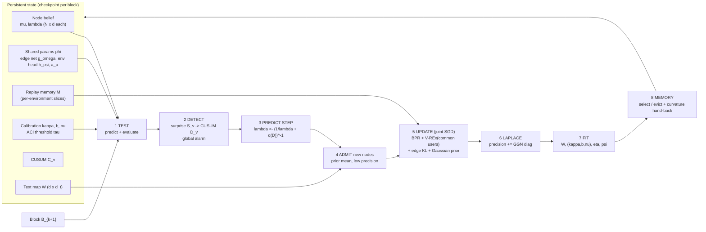

# TIDE-GR — Finalised Architecture Specification (v1.0)

**T**emporally-**I**nvariant, **D**rift-gated, **E**vidence-calibrated **G**raph **R**ecommendation

> **Update 2026-11-23.** Scope, reinforcement learning (R1–R3) and datasets are revised in [TIDE-GR_v2_RL_and_datasets.md](TIDE-GR_v2_RL_and_datasets.md), which takes precedence on those points. Equations below remain valid.
>
> **Status.** This document is the single source of truth for the paper and for code design. Where `mathematical_formulation.md`, `final_architecture.md` or `algorithm_pseudocode.md` differ from it, **this document wins**. It is a design specification, not an implementation. Nothing here has been run yet, so every performance statement is a hypothesis.

---

## 0. Changes from the draft (v0 → v1.0)

An audit of the v0 mathematics found six problems. All are fixed below.

| # | Problem in v0 | Why it matters | v1.0 fix |
|---|---|---|---|
| C1 | Calibration $p=\sigma\big((\kappa m-b)/\sqrt{1+\pi\kappa^2v/8}\big)$ shrinks toward **0.5** as $v$ grows, not toward the base rate (≈1% with 1:99 negatives) | Uncertain users would get *over*-confident relevance probabilities, the opposite of the goal | Three-parameter calibration with a learned variance scale $\nu\ge0$ (Eq. 23). $\nu$ is fitted on validation data, so variance only moderates confidence to the extent that this improves held-out NLL. $\nu=0$ recovers Platt scaling. |
| C2 | The edge-reliability net used the model's own agreement $\mathrm{sg}(\mu_u^\top\mu_i)$ as a feature | **Confirmation-bias loop.** Edges that contradict the current model, which is exactly what drift produces, would be down-weighted, slowing adaptation and reinforcing historical bias | The agreement feature is removed. Edge features are model-independent (Eq. 5). $\pi$ affects **message passing only**; every observed interaction remains a supervised positive. |
| C3 | V-REx compared risks of blocks with different user populations | Risk differences caused by *who* is active (covariate shift, block difficulty) would be wrongly penalised as spurious | The invariance penalty is computed on **common users** (active in ≥2 retained environments), on equal-size samples per environment (Eq. 13). |
| C4 | Mixed scales: mean risks plus a $1/N_k$-scaled Gaussian prior built from summed curvature | The Bayesian update was not internally consistent | All terms are on the **sum scale** (Eq. 11). The optimiser divides by $N_k$ for numerical convenience, which leaves the optimum unchanged. |
| C5 | The ACI threshold was updated once per quarterly block: $T\approx27$ rounds, so the coverage bound was ≈0.8 and useless | The reliability guarantee would be vacuous | Weekly feedback rounds with delayed feedback: $T\approx350$ (Eq. 35). The delayed-feedback bound is a stated **proof obligation** (§15). |
| C6 | Surprise statistic had a $0/0$ for $p=0.5$ pairs; v0 also overstated the meaning of "insufficient evidence ⇒ small surprise" | Numerical instability; overstated mechanism | ε-floored denominator (Eq. 27), and the mechanism is restated precisely in §8. |

---

## 1. Problem statement

**Setting.** The input is a time-ordered stream of implicit-feedback interactions $(u,i,\tau)$ partitioned into blocks $B_1,\dots,B_K$. User and item sets grow over time. The data distribution $P_k(u,i)$ changes from block to block through:

* preference drift;
* popularity, seasonal and exposure drift;
* covariate shift (who is active);
* structural shift (graph density and degree distribution).

**Task.** After each block $k$, output for each user a top-$K$ list for block $k+1$, together with a calibrated confidence and an option to abstain. Then update on $B_{k+1}$.

**Evaluation (prequential).** On the same blocks, the method is scored on four things:

1. accuracy on $B_{k+1}$ *before* seeing it (temporal OOD);
2. retained accuracy on past blocks (forgetting / BWT);
3. calibration and selective risk under drift;
4. accuracy on new users and items as evidence grows.

**Claims we make (falsifiable; hypotheses H1–H8 in `research_gap_and_novelty.md`).** A single per-node Gaussian belief, with drift-gated forgetting, used simultaneously as:

* (a) epistemic uncertainty,
* (b) anti-forgetting regulariser,
* (c) plasticity control,
* (d) new-node prior,

gives a better stability–plasticity trade-off and better-calibrated recommendations under temporal shift than the same capabilities built from independent modules.

**Claims we do not make.**

* Causal identification of preferences.
* A new GNN encoder.
* New conformal or continual-learning primitives.
* Per-user coverage guarantees.

---

## 2. Notation

| Symbol | Meaning | Shape / type |
|---|---|---|
| $\mathcal U_k,\mathcal I_k,\mathcal V_k$ | Users, items and all nodes known after block $k$ | sets; $N_u, N_i, N=N_u+N_i$ |
| $B_k$ | Interactions with $\tau\in[T_{k-1},T_k)$ | set of $(u,i,\tau)$ |
| $G_{\le k}=(\mathcal V_k,E_{\le k})$ | Cumulative bipartite graph | $\lvert E\rvert$ edges |
| $\Delta_{ui}$ | Edge age $T_k-\tau_{ui}$ (last interaction time) | scalar per edge |
| $c_{ui}$ | Repeat count of the edge | scalar per edge |
| $e$ | Environment = time block index | int |
| $\mathcal E_k$ | Training environments at step $k$: $\{k\}\cup$ environments held in memory | set |
| $x_i^e$ | Observable environment covariates of item $i$ in environment $e$ | $\mathbb R^p$ |
| $\theta_v$ | Preference parameter of node $v$ | $\mathbb R^d$ |
| $\mu_v,\lambda_v$ | Belief mean and precision of $\theta_v$ | $\mathbb R^d,\ \mathbb R^d_{>0}$ |
| $\pi_{ui}$ | Posterior probability that edge $(u,i)$ is preference-consistent | $(0,1)$ per edge |
| $\hat A(r)$ | Reliability-weighted symmetric-normalised adjacency | $N\times N$, sparse |
| $P(r)$ | LightGCN propagation operator $\sum_{l=0}^L\frac{1}{L+1}\hat A(r)^l$ | $N\times N$ (never materialised) |
| $m_v,s_v$ | Mean and variance of the propagated representation | $\mathbb R^d$ each |
| $m_{ui},v_{ui}$ | Mean and variance of the score | scalars |
| $p_{ui}$ | Calibrated interaction probability | $(0,1)$ |
| $S_v,C_v,D_v$ | Surprise, CUSUM statistic, drift score | scalars per node |
| $\mathcal M$ | Replay memory (environment-stratified) | set of edges |
| $\phi=\{\omega,\psi,a\}$ | Shared parameters: edge net, environment head, user conformity | small |

---

## 3. Architecture overview



| ID | Module | Algorithm (final) | Input | Output |
|---|---|---|---|---|
| M0 | Stream and environments | Quarterly blocks; environment = block; covariates (Eq. 1) | Raw events, item metadata | $B_k$, $G_{\le k}$, $x^e$, edge attributes |
| M1 | Encoder | Reliability-weighted LightGCN, three passes: mean, variance, sampled | $\mu,\lambda,\pi$, graph | $m_v,s_v,\hat z^{(s)}_v$ |
| M1b | Environment head | $\alpha_u h_\psi(x_i^e)$ with trend forecast | $x^e$, $a_u$ | $s^{\text{env}}$ |
| M2 | Edge reliability | Amortised Bernoulli posterior; age-decaying prior; Concrete relaxation | Model-independent edge features | $\pi_{ui}$ |
| M3 | Node belief | Diagonal Gaussian; online Laplace; drift-gated Bayesian forgetting | Previous belief, $D_v$, GGN | $\mu,\lambda$ |
| M4 | Predictive distribution | Gaussian inner-product moments + MC edge variance + 3-parameter probit calibration | $m,s$, samples, $(\kappa,b,\nu)$ | $m_{ui},v_{ui},p_{ui}$, uncertainty split |
| M5 | Drift detector | Standardised predictive surprise + per-node CUSUM; global JS + CUSUM | $p$ on new block | $D_v$, alarm |
| M6 | Memory | Environment-stratified weighted reservoir; curvature hand-back on eviction | Edges, $\pi$, $D$ | $\mathcal M$ |
| M7 | Reliability layer | Risk-adjusted ranking + selective serving + delayed-feedback ACI | $m,v,p$, realised errors | Lists, flags, $\tau$ |
| M8 | Open world | Neighbour-mean (users) / precision-weighted ridge on text (items) priors + local MAP | New node, first edges, text | $\mu^0,\lambda^0$ |

---

## 4. Model

### 4.1 Environments and observable covariates

For item $i$ in environment $e$, with $n_i^e=\lvert\{(u,i)\in B_e\}\rvert$:

$$
x_i^{e}=\Big[\ \log(1+n_i^{e}),\ \ \log(1+n_i^{e})-\log(1+n_i^{e-1}),\ \ \log(1+\mathrm{age}_i^{e}),\ \ \mathrm{onehot}_4(\mathrm{quarter}(e))\ \Big]\in\mathbb R^{7}. \tag{1}
$$

All quantities in Eq. 1 use data strictly before the time they are used at (leakage rule L2, §14).

### 4.2 Node belief

$$
q_k(\theta_v)=\mathcal N\!\big(\mu_v^{(k)},\ \mathrm{diag}(\lambda_v^{(k)})^{-1}\big),\qquad v\in\mathcal V_k. \tag{2}
$$

### 4.3 Edge reliability (structural latent)

$$
p(r_{ui}=1)=\rho(\Delta_{ui})=\rho_\infty+(\rho_0-\rho_\infty)\,e^{-\Delta_{ui}/\tau_\rho}, \tag{3}
$$

$$
q_\omega(r_{ui}=1)=\pi_{ui}=\sigma\big(g_\omega(f_{ui})\big), \tag{4}
$$

$$
f_{ui}=\big[\log(1+\Delta_{ui}),\ \log d_u,\ \log d_i,\ \log(1+c_{ui}),\ \mathrm{cat}_{ui},\ \tilde y_{ui}\big]. \tag{5}
$$

* $\mathrm{cat}_{ui}$ is the share of $u$'s interactions before $T_k$ in $i$'s top-level category. This is content-based and does **not** depend on the model's parameters.
* $\tilde y_{ui}$ is the normalised rating, if one exists.
* $g_\omega$ is a 2-layer MLP. **Fix C2:** no model-agreement feature.

During training, $\tilde r_{ui}\sim\mathrm{BinConcrete}(\pi_{ui},t_c)$.

### 4.4 Encoder

$$
\hat A_{ui}(r)=\frac{r_{ui}}{\sqrt{(D_u(r)+\epsilon)(D_i(r)+\epsilon)}},\quad D_u(r)=\sum_i r_{ui},\qquad
\hat Z=P(r)\,\Theta,\quad P(r)=\sum_{l=0}^{L}\tfrac{1}{L+1}\hat A(r)^l. \tag{6}
$$

Three passes, all linear and sparse:

$$
\textbf{mean: } m=P(\pi)\,\mu;\qquad
\textbf{variance: } s=P^{\circ2}(\pi)\,\lambda^{-1};\qquad
\textbf{sampled: } \hat z^{(s)}=P(r^{(s)})\,\mu,\ \ r^{(s)}\sim\mathrm{Bern}(\pi). \tag{7}
$$

$P^{\circ2}$ denotes layer-wise propagation with squared normalised weights $\hat A^{\circ2}$. **(A2)** This approximates $\sum_w P_{vw}^2\lambda_w^{-1}$ by ignoring path covariance; it is exact for $L=1$.

### 4.5 Score

$$
s(u,i,e)=\hat z_u^\top\hat z_i+\alpha_u\,h_\psi(x_i^{e}),\qquad \alpha_u=\mathrm{softplus}(a_u). \tag{8}
$$

For the unseen block, the count and trend coordinates of $x$ are forecast (the season one-hot is known):

$$
\hat x_i^{k+1}=x_i^{k}+\eta\,(x_i^{k}-x_i^{k-1}),\qquad \eta\in[0,1]. \tag{9}
$$

---

## 5. Learning objective at step $k$

**Data.** $D_k=B_k^{\text{train}}$ (environment $k$) and $D_e=\mathcal M^e$ for memory environments. $N_k=\sum_{e\in\mathcal E_k}\lvert D_e\rvert$.

**Per-pair loss.** Negatives $j\sim\mathcal N_e$ are drawn uniformly from items active in $B_e$ and not interacted with by $u$. The supervised positive set is *all* observed pairs; $\pi$ only weights message passing.

$$
\ell_e(u,i,j)=-\log\sigma\big(s(u,i,e)-s(u,j,e)\big). \tag{10}
$$

**Objective (sum scale, fix C4).**

$$
\boxed{
\begin{aligned}
\mathcal L_k(\Theta,\phi)=\;&\underbrace{\sum_{e\in\mathcal E_k}\ \sum_{(u,i)\in D_e}\mathbb E_{j,\tilde r}\big[\ell_e(u,i,j)\big]}_{\text{BPR likelihood (current + replay)}}
\;+\;\underbrace{\lambda_{\text{inv}}\,N_k\,\mathrm{Var}_{e\in\mathcal E_k}\!\big[R^{c}_e\big]}_{\text{invariance}}
\;+\;\underbrace{\beta_{\text{KL}}\!\!\sum_{(u,i)\in E_{\le k}}\!\!\mathrm{KL}\big(\mathrm{Bern}(\pi_{ui})\,\|\,\mathrm{Bern}(\rho(\Delta_{ui}))\big)}_{\text{structural posterior}}\\
&+\underbrace{\tfrac12\sum_{v\in\mathcal V_k}\big(\theta_v-\mu_v^{\text{pred}}\big)^{\!\top}\mathrm{diag}\big(\lambda_v^{\text{pred}}\big)\big(\theta_v-\mu_v^{\text{pred}}\big)+\tfrac12\lambda_\phi\big\|\phi-\phi^{(k-1)}\big\|^2_{F_\phi}}_{\text{continual prior}}
\end{aligned}} \tag{11}
$$

The optimiser minimises $\mathcal L_k/N_k$ with Adam. Dividing by a constant does not change the minimiser.

**Common-user environment risk (fix C3).** Let $\mathcal U^c_k=\{u:\ u \text{ has interactions in }\ge2\text{ environments of }\mathcal E_k\}$. For each environment, draw a fixed-size sample $D_e^c\subseteq\{(u,i)\in D_e:u\in\mathcal U^c_k\}$ with $\lvert D_e^c\rvert=n_c$, which equalises estimator noise across environments. Then

$$
R^c_e=\frac{1}{n_c}\sum_{(u,i)\in D^c_e}\mathbb E_{j,\tilde r}\big[\ell_e(u,i,j)\big],\qquad
\mathrm{Var}_e[R^c_e]=\frac{1}{\lvert\mathcal E_k\rvert}\sum_e\big(R^c_e-\bar R^c\big)^2. \tag{12–13}
$$

**Interpretation.**

* The environment head absorbs variation explained by *observable* covariates.
* The penalty removes residual cross-block risk instability *for the same users*. That instability is attributed to block-specific patterns in the preference factor.
* This is **statistical invariance across observed time environments**, not causal identification.
* If $\lvert\mathcal E_k\rvert=1$ (no memory), the penalty is zero. This is why invariance depends on the memory module.

**Gradient estimator for $\omega$.** Gradients pass through the Concrete relaxation, one sample per mini-batch. The KL between Bernoullis is closed form.

---

## 6. Belief dynamics: predict, update, Laplace

### 6.1 Predict step (drift-gated Bayesian forgetting)

Preferences are assumed to follow a random walk, $\theta_v^{(k+1)}=\theta_v^{(k)}+\xi_v$ with $\xi_v\sim\mathcal N(0,q_v I)$:

$$
\mu_v^{\text{pred}}=\mu_v^{(k)},\qquad
\lambda_v^{\text{pred}}=\Big(\big(\lambda_v^{(k)}\big)^{-1}+q_v\mathbf 1\Big)^{-1},\qquad
q_v=\Big(q_0+q_1\tanh\!\big(D_v/h\big)\Big)\cdot\lambda_0^{-1}. \tag{14–15}
$$

* $q_0,q_1$ are dimensionless and expressed relative to the prior variance $\lambda_0^{-1}$.
* With $q_1=1$, a fully drifted node regains about one prior variance of uncertainty.
* Inactive nodes receive only $q_0$. Their confidence therefore decays with staleness, which is intended behaviour.

### 6.2 Update step

$(\mu^{(k+1)},\phi^{(k+1)})=\arg\min\mathcal L_{k+1}$ (Eq. 11) on $B_{k+1}^{\text{train}}\cup\mathcal M$, with prior $(\mu^{\text{pred}},\lambda^{\text{pred}})$.

### 6.3 Laplace precision update

For a pair with margin $x$, $\partial^2\ell/\partial x^2=\sigma(x)(1-\sigma(x))=:\sigma'(x)$. The diagonal GGN with respect to the propagated representations, evaluated at $r=\pi$, is

$$
G_u\mathrel{+}=\sigma'(x)\,(\hat z_i-\hat z_j)^{\circ2},\qquad G_i\mathrel{+}=\sigma'(x)\,\hat z_u^{\circ2},\qquad G_j\mathrel{+}=\sigma'(x)\,\hat z_u^{\circ2}. \tag{16}
$$

Because $\hat Z=P\Theta$ is linear, $\mathrm{GGN}_\Theta=P^\top G\,P$. Keeping the node-diagonal **(A4)**:

$$
\lambda_v^{(k+1)}=\lambda_v^{\text{pred}}+\gamma_F\sum_w P_{wv}^2\,G_w=\lambda_v^{\text{pred}}+\gamma_F\big(P^{\circ2\top}G\big)_v. \tag{17}
$$

* The sum runs over pairs in $B_{k+1}^{\text{train}}\setminus\mathcal M_{\text{new}}$.
* $\gamma_F\in(0,1]$ tempers the curvature.
* $P^{\circ2\top}$ is one transposed squared-weight propagation. On a symmetric bipartite adjacency it is the same operator as the variance pass.

**Each datum is counted exactly once.** Edges selected into memory are excluded from Eq. 17 when selected. On eviction, their curvature, evaluated at the current $\mu$, is added to $\lambda$. Each interaction is therefore represented either by the Gaussian or by raw replay, never both (following Kurle et al., ICLR 2020).

### 6.4 Properties (reductions)

* **P3a.** With $q\equiv0$ and $\lambda_v$ replaced by a scalar times the Fisher diagonal, Eq. 11 reduces to online EWC.
* **P3b.** With $q_v\to\infty$ for node $v$, its prior vanishes and $v$ is fine-tuned freely.
* **P3c.** For a node with no new data, $\mu$ is unchanged and $\lambda$ decays only through $q_0$. The node's uncertainty grows monotonically with time since its last interaction.

---

## 7. Predictive distribution and calibration

**Node-induced variance.** **(A1, A3)** Independent Gaussians; the correlation induced by shared neighbours is ignored:

$$
v^{\text{node}}_{ui}=\sum_{c=1}^d\big(m_{u,c}^2\,s_{i,c}+m_{i,c}^2\,s_{u,c}+s_{u,c}\,s_{i,c}\big). \tag{18}
$$

**Edge-induced variance**, by the law of total variance with $\Theta=\mu$:

$$
v^{\text{edge}}_{ui}=\widehat{\mathrm{Var}}_{s=1..S}\big[\hat z^{(s)\top}_u\hat z^{(s)}_i\big]. \tag{19}
$$

**Score distribution:**

$$
m_{ui}=m_u^\top m_i+\alpha_u h_\psi(\hat x_i^{k+1}),\qquad v_{ui}=v^{\text{node}}_{ui}+v^{\text{edge}}_{ui}. \tag{20–21}
$$

**Calibrated probability (fix C1).** The target is $y_{ui}=\mathbb 1[(u,i)\in B_{k+1}]$, over a candidate distribution of positives plus $n_{\text{neg}}$ uniformly sampled active negatives. **(A5)** uses the probit approximation:

$$
p_{ui}=\sigma\!\left(\frac{\kappa\,m_{ui}+b}{\sqrt{1+\pi\,\nu\,\kappa^2\,v_{ui}/8}}\right),\qquad \kappa>0,\ b\in\mathbb R,\ \nu\ge0. \tag{22–23}
$$

$(\kappa,b,\nu)$ are fitted by BCE on the validation slice. Because $\nu$ is learned, variance moderates confidence only to the extent that doing so improves held-out NLL; $\nu=0$ is Platt scaling.

**Uncertainty decomposition** (delta method):

$$
\underbrace{p(1-p)}_{\text{total}}=\underbrace{p(1-p)-\mathrm{EU}}_{\text{aleatoric}}+\underbrace{\mathrm{EU}}_{\text{epistemic}},\qquad
\mathrm{EU}\approx\big(\sigma'(\kappa m+b)\big)^2\,\kappa^2\,\nu\,v,\quad
\mathrm{EU}=\mathrm{EU}^{\text{node}}+\mathrm{EU}^{\text{edge}}\ \ (\propto v^{\text{node}},\,v^{\text{edge}}). \tag{24}
$$

---

## 8. Drift detection

For node $u$ active in $B_{k+1}$, take its positives and $n_{\text{neg}}$ negatives per positive, scored by the model *before* any update and using the same forecast covariates as at test time. With $\ell_j=-y_j\log p_j-(1-y_j)\log(1-p_j)$:

$$
\mathbb E_0[\ell_j]=\mathcal H(p_j),\qquad \mathrm{Var}_0[\ell_j]=p_j(1-p_j)\Big(\log\tfrac{p_j}{1-p_j}\Big)^2, \tag{25–26}
$$

$$
S_u=\frac{\sum_j\big(\ell_j-\mathcal H(p_j)\big)}{\sqrt{\sum_j\mathrm{Var}_0[\ell_j]+\varepsilon}}\ \ \overset{H_0}{\approx}\ \mathcal N(0,1), \tag{27}
$$

$$
C_u\leftarrow\max\big(0,\ C_u+S_u-\delta\big)\ \ \text{(active)},\qquad C_u\leftarrow\varsigma\,C_u\ \ \text{(inactive)},\qquad D_u=C_u. \tag{28}
$$

**Precise mechanism (fix C6).**

* $H_0$ is "the model's calibrated predictive distribution is correct for $u$ in this block".
* When a node's evidence is weak, $v$ is large. If $\nu>0$, its probabilities are moderated, so each wrong prediction adds a *smaller* excess $\ell_j-\mathcal H(p_j)$ than it would for a confident node.
* Under the alternative "a confident node changed", $p_j$ is extreme and wrong. Both the numerator and the standardisation then make $S_u$ large.
* The power of the test grows with the number of pairs, which is proper evidence accumulation.
* Whether this separates sparse from drifted nodes better than raw-loss detectors is **hypothesis H3**, tested on synthetic preference swaps. It is not assumed.

**Global alarm.**

$$
J_{k+1}=\mathrm{JS}(\mathrm{pop}_k\,\|\,\mathrm{pop}_{k+1}),\qquad \bar S_{k+1}=\mathrm{mean}_uS_u. \tag{29}
$$

An alarm is raised when a CUSUM on $\bar S$ exceeds $h_g$, or when $J_{k+1}$ exceeds the warm-up 95th percentile. The alarm triggers a refit of $(\psi,\eta)$ and $E_{\text{ext}}$ epochs.

---

## 9. Open-world admission

**New user** $u$ with $n\ge0$ revealed interactions $S_u$:

$$
\mu_u^0=\begin{cases}\zeta\cdot\frac1n\sum_{i\in S_u}m_i,& n\ge1\\ \bar\mu^{\text{active}}_{\mathcal U},& n=0\end{cases}\qquad
\lambda_u^0=\lambda_0\mathbf 1. \tag{30}
$$

A local MAP refinement then runs $T_{\text{loc}}$ Adam steps on $\sum_{i\in S_u}\mathbb E_j\ell(u,i,j)+\frac12\lVert\theta_u-\mu_u^0\rVert^2_{\lambda_0}$, with everything else frozen. It is followed by Eq. 17 restricted to $u$. Cost: $O(n\,d\,T_{\text{loc}})$.

**New item** $i$ with frozen-encoder text embedding $t_i\in\mathbb R^{d_t}$:

$$
\mu_i^0=W t_i,\qquad \lambda_i^0=\hat\sigma_{\text{res}}^{-2}, \tag{31}
$$

$$
W=\arg\min_W\sum_{i\in\mathcal I^{\text{warm}}}\big(\mu_i-Wt_i\big)^\top\mathrm{diag}(\lambda_i)\big(\mu_i-Wt_i\big)+\lambda_W\lVert W\rVert_F^2 . \tag{32}
$$

Eq. 32 is solved per output dimension $c$ as a weighted ridge regression: $W_{c,:}=(T^\top\Lambda_cT+\lambda_WI)^{-1}T^\top\Lambda_c\,\mu_{:,c}$. $\hat\sigma^2_{\text{res},c}$ is the $\Lambda_c$-weighted residual variance.

---

## 10. Ranking and selective recommendation

$$
\mathrm{rank}_{ui}=m_{ui}-\beta_r\sqrt{v_{ui}}, \tag{33}
$$

where $\beta_r=0$ is accuracy mode and $\beta_r>0$ is reliability mode. Exploration ($\beta_r<0$) is not evaluated offline.

$$
c_u=\frac1K\sum_{i\in\text{top-}K(u)}p_{ui};\qquad \text{serve the personalised list if } c_u\ge\tau_t,\ \text{otherwise serve the trend list } \arg\mathrm{top}K_i\ h_\psi(\hat x_i)\ \text{flagged as low-confidence.} \tag{34}
$$

**Delayed-feedback ACI (fix C5).** Rounds $t$ are weeks within the stream. Let $\mathrm{err}_t$ be the fraction of users *served* in week $t$ with zero hits in their top-$K$ during the following $W_h=30$ days; with no users served, $\mathrm{err}_t:=0$. Feedback arrives with delay $d=\lceil W_h/7\rceil+1$ rounds.

$$
\tau_{t+1}=\mathrm{clip}_{[\tau_{\min},\tau_{\max}]}\Big(\tau_t+\gamma_{\text{aci}}\big(\mathrm{err}_{t-d}-\alpha\big)\Big). \tag{35}
$$

**Target guarantee (proof obligation, §15).** For any data sequence,

$$
\frac1T\sum_t\mathrm{err}_t\le\alpha+\frac{(\tau_{\max}-\tau_{\min})+\gamma_{\text{aci}}(1+d)}{\gamma_{\text{aci}}\,T}.
$$

This is one-sided, and marginal over time. With $T\approx350$ weekly rounds it is non-vacuous.

---

## 11. Replay memory

The budget is $\lvert\mathcal M\rvert\le M$. There are equal quotas over the most recent $W_{\mathcal M}$ environments, plus one environment per quarter-of-year (four seasonal slots), so recurring seasons are not forgotten.

Within each environment slice, edges are kept by weighted reservoir sampling (A-Res) with priority

$$
\varrho_{ui}=\pi_{ui}\cdot e^{-D_u/h}\cdot e^{-D_i/h}. \tag{36}
$$

Reliable edges of non-drifted nodes are kept preferentially. Evicted edges hand their curvature back to $\lambda$ (§6.3).

---

## 12. Algorithm (final)

```text
WARM-UP (blocks 1..W0, each block an environment):
  init mu ~ N(0, 0.01 I), lambda = lambda0*1, phi
  minimise L (Eq.11) with envs {1..W0}, prior (0, lambda0); early stop on prequential validation
  lambda += gamma_F * P2^T G      (Eq.16-17)
  fit W (Eq.32), (kappa,b,nu) (Eq.23), eta (Eq.9); fill M (Eq.36); C = 0; tau = tau0

FOR k = W0 .. K-1:
  1 TEST    : evaluate on B_{k+1} with cached passes (Eq.7, 18-23, 33-34); feed weekly err_t to ACI (Eq.35)
  2 DETECT  : S_u (Eq.27) for active nodes -> C_u, D_u (Eq.28); global alarm (Eq.29)
  3 PREDICT : lambda_v <- (1/lambda_v + q_v)^-1 for all v (Eq.14-15); store (mu_pred, lambda_pred)
  4 ADMIT   : new users (Eq.30), new items (Eq.31); add edges of B_{k+1} with age 0
  5 UPDATE  : minimise L_{k+1} (Eq.11) on B_{k+1}^train ∪ M, envs {k+1} ∪ envs(M),
              V-REx on common users (Eq.12-13); epochs = E_ext if alarm else E
  6 LAPLACE : M_new <- select (Eq.36); lambda <- lambda_pred + gamma_F * P2^T G over B_{k+1}^train \ M_new
  7 FIT     : W (Eq.32); (kappa,b,nu) on the validation slice (MUST precede the next DETECT); if alarm: refit psi, eta
  8 MEMORY  : insert M_new with quotas; for evicted edges: lambda += gamma_F * curvature
  9 RETAIN  : evaluate on held-out slices of B_1..B_{k+1} (metrics only; never trained on)
```

---

## 13. Complexity and state size

Cost per block, with $E$ epochs, $L$ layers, $d$ dimensions and $S$ edge samples:

| Stage | Cost |
|---|---|
| Update | $O(E\cdot L\cdot\lvert E_{\le k}\rvert\cdot d)$, same order as LightGCN fine-tuning, plus the edge MLP $O(\lvert E\rvert)$ |
| Test passes | $(2+S)$ propagations: $O((2+S)L\lvert E\rvert d)$ |
| Laplace | One pass over pairs plus one propagation |
| Detect | $O(\#\text{pairs})$ |
| Admission | $O(n\,d)$ per new node |

**Expected overhead.** About 1.3–1.6× LightGCN fine-tuning (estimate; must be measured).

**State size.**

* $\mu,\lambda$: $2Nd$ floats, i.e. 2× LightGCN.
* $\phi$: small.
* Memory: $M$ edges.
* Per edge: one float for $\pi$ (cache).
* Per node: one float for $C_v$.

---

## 14. Defaults, search ranges and leakage rules

| Hyperparameter | Default | Search (warm-up only, equal budget for all methods) |
|---|---|---|
| $d$, $L$ | 64, 2 | $L\in\{2,3\}$ |
| $\lambda_{\text{inv}}$ | 1 | {0, 0.1, 1, 10} |
| $n_c$ (common-user sample per environment) | 4096 | fixed |
| $\beta_{\text{KL}}$ | 1e-2 | {1e-3, 1e-2, 1e-1} |
| $\rho_0,\rho_\infty,\tau_\rho$ | 0.95, 0.6, 2 blocks | $\rho_\infty\in\{0.5,0.7\}$; $\tau_\rho\in\{1,2,4\}$ |
| $t_c$ | 0.5 | fixed |
| $\lambda_0$ | 1 (≡ weight decay) | {0.1, 1, 10} |
| $q_0,q_1$ | 1e-3, 0.5 | $q_0\in\{0,10^{-3}\}$; $q_1\in\{0.1,0.5,1\}$ |
| $\delta,h,\varsigma$ | 0.5, 4, 0.9 | $h\in\{3,5\}$ |
| $\gamma_F$ | 1 | {0.1, 1} |
| $M$, $W_{\mathcal M}$ | 2% of $\lvert B\rvert$ per environment, 8 | $M\in\{1\%,5\%\}$; $W_{\mathcal M}\in\{4,8\}$ |
| $\zeta,T_{\text{loc}}$ | 1, 20 | grid |
| $\lambda_W$ | 1 | {1e-2, 1, 1e2} |
| $\beta_r$ | 0 (accuracy) / 0.5 (reliability) | {0, 0.5, 1} |
| $\alpha,\gamma_{\text{aci}},W_h$ | task-defined, 0.05, 30 days | — |
| $n_{\text{neg}}$, $S$, $\varepsilon$ | 99, 4, 1e-6 | fixed |

**Leakage rules.**

* **L1.** No global k-core; filtering uses past data only.
* **L2.** Covariates, degrees and categories are computed from data before their use time.
* **L3.** Validation is the time-last 10% of the training block.
* **L4.** Retention slices are never trained on, including through replay.
* **L5.** The text encoder must be released before the stream window, or a no-text ablation is reported.
* **L6.** De-duplicate on parent_asin.

---

## 15. Assumptions, approximations and proof obligations

| ID | Statement | Status |
|---|---|---|
| A1 | Diagonal Gaussian beliefs; independence across nodes | Approximation; state in the paper |
| A2 | Squared-weight variance propagation ignores path covariance (exact for $L=1$) | Approximation; measure against MC on Video_Games |
| A3 | Inner-product variance ignores the $u$–$i$ correlation from shared neighbours | Approximation |
| A4 | Node-diagonal GGN from the BPR term only. The belief is a Laplace approximation of a *generalised* posterior, because V-REx makes the loss non-additive | Approximation; state explicitly |
| A5 | Probit approximation (Eq. 23) | Standard |
| A6 | CLT null for $S_u$ | Verify empirically on non-drifted synthetic users (QQ-plot) |
| PO1 | Delayed-feedback ACI bound (§10) | **Must be derived or cited before submission.** Fallback: report the empirical long-run error only and claim no guarantee |
| PO2 | Propositions P1 (Eq. 18), P2 (Eqs. 25–26), P3a–c (§6.4) | Short derivations for the paper's Method/Analysis section; all are elementary |

---

## 16. Decisions: locked vs. open until the pilot

**Locked (paper and code proceed on these):**

* LightGCN backbone with block snapshots.
* Gaussian beliefs with online Laplace and drift-gated forgetting.
* Standardised-surprise CUSUM.
* Edge posterior with an age prior and model-independent features.
* Three-parameter calibration and delayed-feedback ACI.
* Environment = time block.
* Neighbour-mean / text-ridge priors.
* Prequential protocol.
* Amazon-2023 Toys (primary), Yelp (secondary), Video_Games (pilot).

**Open — decided by the 2-week pilot** on Video_Games, with M1 + M3 + M5 only plus synthetic drift:

1. Does surprise-CUSUM beat raw-loss CUSUM (H3)? If not, revisit M5 before building anything else.
2. Does V-REx on common users beat tuned ERM? If not, demote M1b + V-REx to optional, keeping the environment head (PDA-style) because it is cheap.
3. $L=2$ vs. $L=3$ given approximation A2.
4. Weekly vs. bi-weekly ACI rounds, depending on per-week user volume.

---

## 17. Paper skeleton (maps to this spec)

1. **Introduction.**
   * Confident errors under temporal shift.
   * The three disconnected literatures.
   * Contributions C1–C4.
2. **Related work.** Static OOD graph rec; streaming graph rec; uncertainty and calibration in rec; Bayesian continual learning; dynamic-graph OOD.
3. **Problem formulation.** Prequential temporal-OOD continual recommendation (§1 and the protocol).
4. **Method.**
   * 4.1 Belief model and encoder (§4).
   * 4.2 Objective (§5).
   * 4.3 Belief dynamics (§6).
   * 4.4 Predictive uncertainty and calibration (§7).
   * 4.5 Evidence-vs-change detector (§8).
   * 4.6 Open world (§9).
   * 4.7 Reliable serving (§10).
5. **Analysis.** P1–P3, the ACI bound (PO1), and the complexity table (§13).
6. **Experiments.** H1–H8, as in `experimental_design.md`; the coupling ablation comes first.
7. **Limitations.** A1–A6; no interactive feedback loop; statistical, not causal, invariance.

---

## 18. Code-design blueprint (interfaces only; nothing implemented)

| Component | Responsibility | Key interface (inputs → outputs) |
|---|---|---|
| `stream` | Read raw data, de-duplicate, build blocks, environment covariates, splits and entity tracks | raw files → `Block[k]` (edges, timestamps, new-node lists), `Covariates[k]`, `Splits` |
| `graph` | Cumulative sparse bipartite graph; edge attributes; normalised and squared-normalised propagation | `Block` → `GraphState`; `propagate(X, weights, squared=False, transpose=False)` |
| `belief` | Store $\mu,\lambda$; predict step; admission; checkpoint | `predict_step(D)`, `admit(new_nodes, priors)`, `state_dict()` |
| `edge_net` | $g_\omega$, prior $\rho$, Concrete sampling, KL | edge features → `pi`, `sample()`, `kl()` |
| `env_head` | $h_\psi$, $a_u$, forecast $\hat x$ | `Covariates` → $s^{\text{env}}$ |
| `objective` | BPR per environment, common-user V-REx, KL, Gaussian prior | batch, state → scalar loss |
| `trainer` | Joint Adam loop, environment-stratified batching, early stopping | data, state → updated state |
| `laplace` | GGN diagonal (Eq. 16–17), curvature hand-back | pairs, state → $\Delta\lambda$ |
| `predictive` | Three passes, $m,v,p$, uncertainty split, ranking | state → scores, variances, probabilities |
| `calibration` | Fit $(\kappa,b,\nu)$; ACI controller | validation pairs → params; err stream → $\tau$ |
| `drift` | Surprise, CUSUM, global alarm | predictive outputs on the new block → $D$, alarm |
| `memory` | Stratified A-Res with seasonal slots; eviction log | edges, $\pi$, $D$ → `Memory`, evicted set |
| `openworld` | Neighbour-mean prior, weighted ridge $W$, local MAP | new nodes, text embeddings → priors |
| `eval` | Prequential runner; ranking, calibration, continual and open-world metrics; statistics | state, blocks → metric tables |
| `baselines` | Adapters running each baseline under the same protocol | config → metric tables |
| `configs` | One config per experiment / ablation (Hydra-style) | — |

**Data contract per block checkpoint:**

$\{\mu,\lambda,\phi,\mathcal M,(\kappa,b,\nu),\tau,C,W,\eta\}$ plus the RNG state. Saving one checkpoint per block lets any later stage be re-run in isolation.

**Build order.**

1. `stream` + `graph` + `eval`, with a LightGCN baseline reproduced.
2. `belief` + `laplace` + `predictive` (M3, M4).
3. `drift` (M5), then the **pilot decision point**.
4. `memory` + `objective` V-REx (M6, invariance).
5. `edge_net` (M2).
6. `calibration` (M7).
7. `openworld` (M8).
8. `baselines`.
