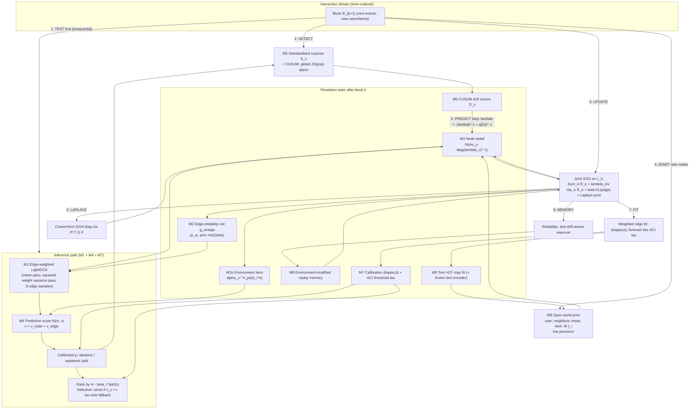

# Stage 5 — Final Architecture: TIDE-GR

> **Note.** The module structure below is unchanged in v1.0. Equations, edge features, calibration and the ACI schedule are finalised in **[TIDE-GR_spec_v1.md](TIDE-GR_spec_v1.md)**, which takes precedence wherever the two differ.

**TIDE-GR — Temporally-Invariant, Drift-gated, Evidence-calibrated Graph Recommendation**

> **One-sentence summary.** A LightGCN recommender whose node embeddings are maintained as Gaussian beliefs. Their precision is updated online (Laplace) and deflated per node by a calibrated drift test (Bayesian forgetting). The same belief, together with a time-decaying edge-reliability posterior, provides:
>
> * the predictive uncertainty;
> * the anti-forgetting regulariser;
> * the per-node plasticity;
> * the prior for unseen nodes.
>
> Stable preferences are separated from transient, forecastable environment effects by a risk-variance penalty across time blocks retained in a stratified replay memory.

**Name check.** "TiDE" is an existing time-series forecasting model (Das et al., 2023), and "TIDE-GR" must be checked for collisions before submission. The name is provisional.

---

## 1. Architecture diagram

---

## 2. Modules

| ID | Module | Selected algorithm | Input | Output | Scientific purpose |
|---|---|---|---|---|---|
| M0 | Temporal blocking and environments | Quarterly blocks; environment = block; covariates $x_i^e$ | Event stream | $B_k$, $G_{\le k}$, $x_i^e$, edge ages | Defines shift and environments (Challenge A) |
| M1 | Graph encoder | Edge-weighted LightGCN (linear) with mean, squared-weight and sampled passes | $\mu,\lambda,\pi$, $G_{\le k}$ | $m_v$, $s_v$, $\hat z_v^{(s)}$ | Collaborative signal; closed-form uncertainty propagation |
| M1b | Environment term | $\alpha_u h_\psi(x_i^e)$ with PDA-style forecast $\hat x^{k+1}$ | $x_i^e$, $a_u$ | $s^{\text{env}}$ | Absorbs observable transient factors (Challenge B) |
| M2 | Edge reliability | Amortised Bernoulli posterior $q_\omega$; time-decaying prior; Concrete relaxation | Edge features | $\pi_{ui}$, $v^{\text{edge}}$ | Structural uncertainty; staleness (Challenge C) |
| M3 | Node belief | Diagonal Gaussian; online Laplace precision; drift-gated process noise | Previous belief, $D_v$, GGN | $\mu_v,\lambda_v$ | Epistemic uncertainty **and** anti-forgetting regulariser **and** plasticity (C, D) |
| M4 | Predictive distribution | Gaussian inner-product moments + MC edge variance + probit-calibrated probability | $m,s$, edge samples, $\kappa,b$ | $m_{ui},v_{ui},p_{ui}$, AU/EU split | Predictive uncertainty (C) |
| M5 | Shift detector | Standardised predictive surprise + per-node CUSUM; global JS(popularity) + CUSUM alarm | $p_{ui}$ on new block, popularity histograms | $D_v$, global alarm | Separates sparse evidence from change; gates M3, M6, M1b refit (A, C) |
| M6 | Replay memory | Environment-stratified A-Res reservoir, priority $\pi\cdot e^{-D_u/h}e^{-D_i/h}$ | Block edges, $\pi$, $D$ | $\mathcal M_k$ | Provides past environments for invariance; retention (B, D) |
| M7 | Calibration and selective layer | Post-hoc $(\kappa,b)$; ACI threshold on selective error; LCB ranking | Validation slice, realised errors | $\tau_k$, served/abstained lists | Reliable recommendations under drift (C) |
| M8 | Open-world admission | User: neighbour-mean prior (IDCF/INMO-style). Item: precision-weighted ridge from frozen text embedding. Low prior precision; local MAP refinement | New node, first interactions, item text | $\mu^0,\lambda^0$ | New users/items without retraining (E) |
| — | Objective | $\mathcal L_k$ (see `mathematical_formulation.md` §12) | — | — | — |

**Nothing is redundant.**

* Invariance is the only mechanism that separates preference from environment.
* Edge reliability is the only edge-level mechanism.
* The node belief is the single shared state for uncertainty, retention and cold-start.
* Memory is required by invariance and helps retention.
* The detector is the only mechanism that sets per-node plasticity.
* Calibration is the only mechanism that gives a guarantee under drift.

---

## 3. Mapping to the research challenges

| Research Problem | Architecture Module | Selected Method | How It Addresses the Problem | Supporting Paper |
|---|---|---|---|---|
| A. Continuous distribution shift | M0, M3, M5, M1b | Prequential blocks; Kalman-style predict step with drift-gated process noise; forecast environment term | Nodes that drift become plastic, stable nodes stay anchored, and popularity trends are extrapolated to the next block | Kurle et al. ICLR'20 (Bayesian forgetting); Gultekin & Paisley 2014/15 (Collaborative Kalman Filter); PDA SIGIR'21 (popularity forecast) |
| B. Stable vs. spurious temporal signals | M1b + V-REx in $\mathcal L_k$ + M6 | Preference/environment factorisation; risk-variance penalty over time-block environments held in memory | Variation explained by observable covariates goes to the environment term; residual cross-block instability is penalised out of the preference factor | Krueger et al. ICML'21 (V-REx); InvCF WWW'23; DICE WWW'21; PDA |
| C1. Structural uncertainty | M2 | Variational Bernoulli edge posterior with time-decaying prior | Gives the probability that an edge is still preference-consistent; propagates into $v^{\text{edge}}$ | BGCN-Rec KDD'20; Zhang et al. AAAI'19 (Bayesian GCN); Maddison/Jang 2017 (Concrete) |
| C2. Predictive uncertainty and calibration | M3, M4, M7 | Laplace node belief → closed-form score variance → probit-calibrated probability; ACI selective threshold | Insufficient evidence raises $v$ and lowers confidence; the long-run selective error is controlled under any drift | Ritter et al. NeurIPS'18; Daxberger et al. NeurIPS'21; Gibbs & Candès NeurIPS'21; Kweon et al. AAAI'22 |
| C3. Evidence vs. change | M5 | Standardised predictive surprise + CUSUM | Sparse nodes give small surprise (moderated predictions); confident nodes that change give large surprise | Page (1954) CUSUM; our derivation (`mathematical_formulation.md` §9) |
| D. Catastrophic forgetting | M3, M6 | Online-Laplace prior with per-node precision; drift-gated forgetting; reliability-aware stratified replay | Knowledge is kept where evidence is high and no drift is detected; stale knowledge is released only where drift is detected | Kirkpatrick et al. PNAS'17 (EWC, special case); Kurle et al. ICLR'20; Chaudhry et al. 2019 (tiny memories); SAER CIKM'21 |
| E. Open-world users/items | M8 | Bayesian new-node prior (neighbour mean / text regression) + local MAP | O(degree) insertion with no retraining; new nodes are automatically flagged as uncertain | IDCF ICML'21; INMO SIGIR'22; DropoutNet NeurIPS'17; TDRO AAAI'24 |

---

## 4. Flows

### 4.1 Training flow (warm-up)

1. Build $G_{\le W_0}$ and environments $1..W_0$.
2. Initialise $\mu\sim\mathcal N(0,0.01)$, $\lambda=\lambda_0$, $\omega,\psi,a$.
3. Minimise $\mathcal L$ with all warm-up blocks as environments (no memory is needed yet). Early-stop on prequential validation.
4. Compute the Laplace precision, fit $W$, $(\kappa,b)$ and $\eta$, initialise $\tau$ and the CUSUMs at 0.
5. Fill the memory from the warm-up blocks.

### 4.2 Continual adaptation flow (each block)

Order: **test → detect → predict → admit → update → Laplace → fit → memory.** See `algorithm_pseudocode.md`. Adaptation runs every block. Drift only modulates it, so there is no fragile retrain/no-retrain decision.

### 4.3 Inference flow

For user $u$:

1. Compute $m_u, s_u$ from the cached mean and variance passes.
2. For candidates $i$, compute $m_{ui}$ with the forecast covariates, $v_{ui}$ (closed form plus cached edge-sample variance), and $p_{ui}$.
3. Rank by $m-\beta_r\sqrt v$.
4. If $c_u<\tau_k$, return the environment-trend fallback with a low-confidence flag.

Cost: one inner product plus $O(d)$ variance terms per candidate. Node-level passes are cached once per block.

### 4.4 Uncertainty estimation flow

* Edge: $\pi\to$ entropy.
* Node: $\lambda\to s$ via squared propagation.
* Score: $v^{\text{node}}+v^{\text{edge}}$.
* Probability: probit.
* Decomposition into aleatoric and epistemic (node / edge) components.
* Calibration: $(\kappa,b)$ refit per block. Selective threshold: ACI.

### 4.5 Distribution-shift detection flow

* **Per node:** standardised surprise $S_v$ on the incoming block, computed before training, then CUSUM to give $D_v$. $D_v$ feeds:
  * the process noise $q_v$ (M3);
  * the memory priority (M6).
* **Global:** JS divergence between popularity histograms, plus a CUSUM on $\bar S$. An alarm triggers a refit of $h_\psi$ and $\eta$, and extended epochs.

### 4.6 New-user / new-item handling

1. On first appearance, create $\mu^0$ (neighbour mean, population mean, or $Wt_i$) and $\lambda^0$ (small).
2. Insert the node's edges into the graph with prior $\rho(0)$.
3. Optionally run a local MAP refinement as interactions arrive.
4. At the next block update, the node joins joint training like any other.

### 4.7 Historical knowledge preservation

* The precision-weighted prior retains well-evidenced, non-drifted node positions.
* The memory retains reliable past interactions per environment, including one per season, so recurring seasons are not forgotten.
* Curvature is moved from memory to the Gaussian on eviction, so no datum is lost or double-counted.

---

## 5. Module interactions and dependencies

* **M5 → M3, M6, M1b.** The detector is the control signal. If M7 calibration is poor, $S_v$ is biased, so **M7 must be refit before M5 runs** on the next block (the order is enforced in the pseudocode).
* **M6 → invariance.** Without memory the invariance penalty is degenerate ($|\mathcal E_k|=1$).
* **M3 ↔ M8.** New nodes are just nodes with a weak prior. No special code path is needed after admission.
* **M2 ↔ M3.** Both reduce the influence of the past, at the edge level and the node level respectively. Ablations separate them. Expected interaction: M2 handles *partial* staleness (some edges of a user), M3 handles *wholesale* drift.

---

## 6. Reuse from MM-CLightRec (description-level only)

* **Reused:** the LightGCN propagation rule; the idea of a content-based cold-start prior, reduced to one frozen text encoder and a linear map.
* **Not reused:**
  * multimodal channels, fusion and cross-attention (not needed for the research question);
  * hierarchical contrastive learning (not a temporal-invariance mechanism);
  * VGAE uncertainty (replaced by M2 + M3, which separate edge and node uncertainty, update over time, and are calibrated).
* **The contribution of TIDE-GR is disjoint from MM-CLightRec's.**

---

## 7. Strongest alternative and when it would win

**Alternative S2:** an event-based continuous-time encoder (TGN/DyGFormer-style) + a deep ensemble (M=5) + replay/EWC + time-window DRO. See `architecture_comparison.md` §7.

Not selected because of:

* per-block cost of ≈5× or more;
* weak evidence that complex temporal encoders beat simple ones for top-K recommendation (EdgeBank, GraphMixer, TGB);
* no coupling between the uncertainty, retention and cold-start modules.

S2 could outperform TIDE-GR when:

* intent shifts at minute or session scale, which quarterly or even daily snapshots miss;
* uncertainty quality matters more than cost, since ensembles are the most robust under shift (Ovadia et al. 2019);
* rich node features make event memories informative from the first event.

We quantify the uncertainty side of this by including a 5-member ensemble of our backbone as an upper reference.
